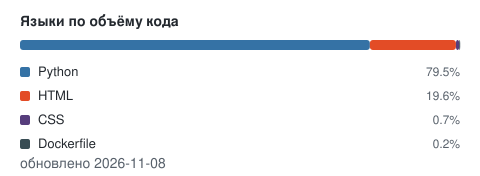

<h1 align="center">Александр Бачевский</h1>

  Python backend · Django / DRF · PostgreSQL · Docker

  <em>Инженерный бэкграунд: производство, телеметрия, интеграция софта с оборудованием.</em>

  
  
  
  
  
  
  
  

---

## Обо мне

Пишу backend на Python: Django, Django REST Framework, PostgreSQL, Celery, Docker. Собираю сервисы целиком — от модели данных и API до деплоя за Nginx с CI на GitHub Actions.

До разработки 14 лет работал инженером: системы мониторинга и телеметрия (ГЛОНАСС), пусконаладка производственных линий, интеграция оборудования с шеф-инженерами из Германии, Китая и Испании. Оттуда привычка проверять данные и доводить решение до работающего результата, а не до красивой презентации.

Сейчас проектирую внутренний сервис учёта производственных данных на действующем производстве и развиваюсь в сторону интеграций: IoT, промышленная автоматизация, телеметрия.

**Ищу:** Интересные проекты на Python backend, удалённо или гибрид.

---

## Проекты

### [sky_tbook](https://github.com/Alex-399745146/sky_tbook) &nbsp; 

Backend LMS-платформы: курсы, уроки, платежи и подписки, роли модераторов и владельцев, JWT, email-уведомления, авто-деактивация неактивных пользователей.
`Django 4.2` `DRF` `PostgreSQL` `Celery` `Redis` `Docker` · CI (pytest, flake8, black, isort, mypy) и автодеплой на VPS через GitHub Actions.

### [sky_habit](https://github.com/Alex-399745146/sky_habit) &nbsp; 

API трекера привычек: JWT, публичные и приватные привычки, связанные привычки и вознаграждения, планировщик напоминаний на Celery Beat, Telegram-бот, Swagger/ReDoc. 54 теста, Docker Compose с Nginx и Gunicorn.
`DRF` `PostgreSQL` `Redis` `Celery Beat` `Telegram Bot API` `Nginx`

### Fish Farm Control — MVP системы управления УЗВ

Система для фермы радужной форели: баки, стада, биомасса, кормление, план кормления, прогноз роста и себестоимости. Обмен с исполнительными устройствами по **Modbus RTU через RS-485**, связь верхнего уровня с оборудованием среднего и полевого уровней.
`Python` `Django` `SQLite` `Django Admin` · код закрыт по договорённости с заказчиком, готов разобрать архитектуру на встрече.

### [sky_shop](https://github.com/Alex-399745146/sky_shop) · [sky_db_inf](https://github.com/Alex-399745146/sky_db_inf)

Интернет-магазин на Django с кастомным пользователем, правами владельца и модератора (`Django`, `PostgreSQL`). Дашборд мониторинга воздушных судов: OpenSky API, Nominatim, агрегация в PostgreSQL, графики в Streamlit (`pandas`, `Streamlit`).

Остальные репозитории

- [sky_send](https://github.com/Alex-399745146/sky_send) — сервис email-рассылок: клиенты, сообщения, логи, роли
- [sky_note](https://github.com/Alex-399745146/sky_note) — дневник: поиск, права доступа, Docker Compose
- [sky_bank](https://github.com/Alex-399745146/sky_bank) — банковские транзакции: pandas, JSON, Excel-отчёты
- [sky_list](https://github.com/Alex-399745146/sky_list) — воздушные суда: OpenSky + Nominatim, CLI, pytest
- [earth_rotat](https://github.com/Alex-399745146/earth_rotat) — CLI-анимация вращения Земли на Rich

---

## Стек

- **Backend** — Python 3.13 · Django 4.2/5.2 · DRF · REST API · Celery · Celery Beat
- **Данные** — PostgreSQL · Redis · Django ORM · SQL · миграции · pandas
- **Инфраструктура** — Docker · Docker Compose · Nginx · Gunicorn · Linux · GitHub Actions · Poetry
- **Интеграции** — REST · JWT · drf-spectacular · Telegram Bot API · Modbus RTU / RS-485
- **Качество** — pytest · unittest · flake8 · black · isort · mypy · PEP 8
- **Изучаю** — FastAPI · SQLAlchemy · Alembic · RabbitMQ · MQTT

---

## Статистика

  

  

---

## Контакты

  
  
  

  Калужская область · удалённо / гибрид · готов к переезду в Москву или Санкт-Петербург

